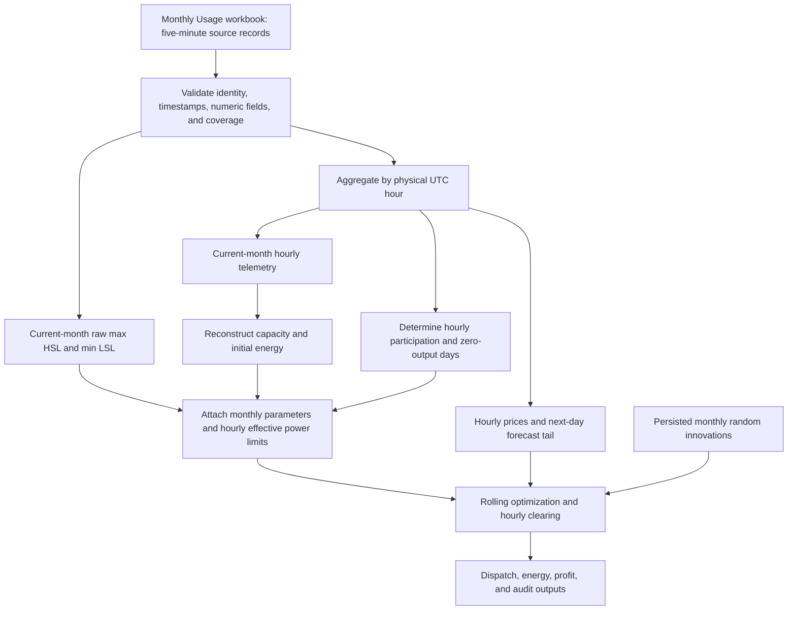

# ESS Data Processing and Parameter Generation: One-Hour Version

This guide explains how the current [Rolling_Window_1hour.py](../Rolling_Window_1hour.py) workflow converts five-minute ERCOT records into hourly inputs and generates the parameters of an equivalent energy storage system (ESS). It describes the default monthly configuration in [experiment_config_1hour.json](../experiment_config_1hour.json), which uses schema version 3.

For each resource and month, Rolling power limits use raw operator-submitted HSL/LSL extrema. Capacity and initial energy remain reconstructed from historical hourly telemetry; source SOC limits do not set the energy envelope. These parameters are not manufacturer nameplate specifications. Benchmark retains its existing telemetry-derived power policy.

## 1. Workflow and source-code responsibilities



| File / function | Responsibility |
|---|---|
| `Experiment_Data_1hour.py: load_experiment()` | Load and validate the experiment configuration and monthly boundaries. |
| `Monthly_Data_1hour.py: normalize_source()` | Normalize resource identity and timestamps; reject duplicate UTC slots. |
| `Monthly_Data_1hour.py: inspect_monthly_member()` | Validate coverage, aggregate hourly records, derive availability, and attach ESS parameters. |
| `Experiment_Data_1hour.py: reconstruct_ess()` | Reconstruct energy parameters and legacy telemetry ratings; Rolling replaces only the power ratings using `submitted_power_parameters()`. |
| `Rolling_Window_1hour.py: _load_experiment_resources()` | Convert the shared hourly dataset into `ResourceData` for Rolling. |
| `Experiment_Data_1hour.py: prepare_random()` | Generate or verify reproducible monthly forecast innovations. |
| `Rolling_Window_1hour.py: _run_resource_with_environment()` | Build each horizon, clear the generated bid, and carry energy forward. |

The default experiment contains 13 resources and January–June 2026, giving 78 configured resource-months before coverage exclusions. Each month is initialized independently; modeled energy is not carried from one month's run into the next.

## 2. Input data and time handling

### 2.1 Monthly input files

The default input directory is `Data/Micro/Six_Month_Data/`. Each workbook is named:

```text
<resource>_Usage_<YYYYMM>.xlsx
```

The loader reads its `Usage` worksheet. The required time and identity fields are `Resource Name`, `SCED Time Stamp`, `Standard 5-Minute Time Stamp`, and `SCED Timestamp UTC`. The essential modeling fields are `LMP`, `Telemetered Net Output`, and `Telemetered Resource Status`. The shared loader also requires the TPO bid-curve columns.

`HSL` and `LSL` are required for Rolling. Blank values are ignored independently, but each bound needs at least one valid current-month value. Nonblank invalid values are errors; no telemetry fallback is used. Individual submissions may cross zero: only the final monthly max(HSL) and min(LSL) must form a nonnegative discharge and nonpositive charge boundary. `State of Charge`, `Minimum SOC`, and `Maximum SOC` remain optional audit fields.

Each file must cover the current month plus the first local calendar day of the following month. The entire next day is checked even if only part of it is needed by the selected forecast horizon.

### 2.2 Physical hours and daylight saving time

The implementation uses UTC to identify physical five-minute slots and hours, while local days and months follow `America/Chicago`:

1. Parse the UTC timestamp, round to seconds, and floor to its five-minute slot.
2. Convert that slot to local time and verify agreement with `Standard 5-Minute Time Stamp`.
3. Reject duplicate five-minute UTC slots and sort chronologically.
4. Group records by the UTC hour containing each slot.

Every modeled interval is one elapsed hour, so `interval_hours = 1.0`. A daylight saving transition changes the number of hours in the local month; the missing spring clock hour is not fabricated.

| Month | Implementation hours |
|---|---:|
| January 2026 | 744 |
| February 2026 | 672 |
| March 2026 | 743 |
| April 2026 | 720 |
| May 2026 | 744 |
| June 2026 | 720 |

Excel exports contain local `Time` / `Hour Start` and a separate `Hour Start UTC`. Use the UTC column to check physical continuity.

## 3. From five-minute records to hourly inputs

For hour $h$, let $I_h^P$ contain the records with valid telemetry power and $I_h^\lambda$ contain those with valid prices. The loader computes the two means independently:

$$
P_h = \frac{1}{|I_h^P|}\sum_{i\in I_h^P}P_i,
\qquad
\lambda_h = \frac{1}{|I_h^\lambda|}\sum_{i\in I_h^\lambda}\lambda_i.
$$

Here, $P_h$ is hourly mean net power in MW and $\lambda_h$ is hourly mean LMP in USD/MWh. Positive power means discharge/export; negative power means charge/import. All recorded statuses contribute to these means.

Missing five-minute observations are not interpolated, forward-filled, or replaced with zero. For example, an hour with ten valid power samples uses their sum divided by ten, not twelve. The resulting mean is used as the representative power for the full one-hour model interval.

| Retained field | Meaning |
|---|---|
| `Source Record Count` | Number of source records present in the hour. |
| `Power Sample Count` / `Price Sample Count` | Number of valid samples used in each mean. |
| `Source Coverage` / `Power Coverage` / `Price Coverage` | Corresponding count divided by 12. |
| `Source Rows`, `Source SCED Times`, `Source Standard Times` | Traceability to original observations. |
| `Source Status Counts` | Counts of normalized status codes within the hour. |

Source HSL and LSL are averaged for auditing. Observed SOC is the first source SOC value of the hour; observed minimum and maximum SOC use the hourly minimum and maximum of their respective source fields.

### 3.1 Missing data and invalid inputs

| Condition | Handling |
|---|---|
| Some five-minute slots or price/power values are missing, but every hour has at least one valid sample of each | Retain the hour and report reduced coverage. |
| Missing monthly file, complete local day, complete physical hour, or all price/power samples within an hour | Exclude the resource-month as a coverage failure. |
| Resource identity mismatch, inconsistent timestamps, duplicate UTC slots, or invalid nonblank price/power values | Report an invalid-input error and stop the monthly load. |
| Missing or invalid required bid curves | Apply the shared curve rules below; unresolved or malformed required curves cause an error. |

The shared loader validates historical TPO curves for consistency with Benchmark, although Rolling generates its own optimized bids. A wholly empty curve can use the latest earlier valid complete curve, including one from an earlier monthly file. It cannot use a future curve or fill individual missing bid points. A malformed nonempty curve in a trading implementation hour is rejected. Tail-hour curves are not resolved for dispatch.

## 4. Generate the monthly ESS parameters

Only the current month's hourly telemetry enters `reconstruct_ess()`. The next-month tail and the `--steps` execution limit do not affect parameter generation. Telemetry is used across all statuses, before applying trading-availability gates.

Let $N$ be the number of implementation hours, $\Delta t=1$ h, and $\eta=0.95$. The same one-way efficiency is used for charging and discharging, implying a modeled round-trip efficiency of $\eta^2=0.9025$.

### 4.1 Rated charging and discharging power

Rolling uses the raw five-minute submissions within the current local calendar month, across all statuses:

- Discharge rating: `max(HSL)` MW.
- Signed charging bound: `min(LSL)` MW; the solver receives its nonnegative magnitude.

These extrema are computed before hourly averaging, without rounding. The next-month tail never changes the ratings; every forecast hour uses the implementation month's fixed ratings subject to that hour's trading gate. The execution `--steps` cap does not change the statistics.

Exports retain `Submitted HSL Maximum` and `Submitted LSL Minimum` for each hour, plus `Power Limit Policy`. A full-month result can reconstruct its power ratings from these raw hourly extrema. `HSL`/`LSL` themselves remain hourly mean audit columns. Benchmark continues using rounded hourly telemetry extrema.

### 4.2 Reconstruct a cumulative energy trajectory

Start with a relative energy of zero, $S_0=0$. Convert each hourly net power to a change in stored energy:

$$
\Delta E_h=
\begin{cases}
-P_h\Delta t/\eta, & P_h\ge 0 \quad\text{(discharge)},\\
-P_h\eta\Delta t, & P_h<0 \quad\text{(charge)}.
\end{cases}
$$

Then accumulate:

$$
S_h=\sum_{i=1}^{h}\Delta E_i,\qquad h=1,\ldots,N.
$$

Discharge removes more stored energy than the electricity exported; charge stores less energy than the electricity imported. The initial zero point is explicitly included when finding the trajectory's extrema.

### 4.3 Capacity and initial stored energy

Let $S_{\min}=\min_{0\le h\le N}S_h$ and $S_{\max}=\max_{0\le h\le N}S_h$. The generated parameters are:

$$
E_{\mathrm{capacity}}=\operatorname{ceil}_{0.1}(S_{\max}-S_{\min}),
\qquad
E_{\mathrm{initial}}=\max(0,-S_{\min}).
$$

The model's energy bounds are:

$$
E_{\min}=0,\qquad E_{\max}=E_{\mathrm{capacity}}.
$$

Shifting the relative trajectory by $E_{\mathrm{initial}}$ makes its minimum zero. Its maximum fits within the upward-rounded capacity. The initial energy is **not rounded** to 0.1 MWh.

This is the energy envelope needed to accommodate the accumulated hourly telemetry under the assumed efficiency. Persistent net charging or discharging over the month contributes to this envelope; the algorithm does not remove a trend or impose a cyclic endpoint.

### 4.4 Worked numerical example

For illustration, consider a three-hour telemetry sequence $P=[9.5,-10,0]$ MW:

| Point | Net power (MW) | Stored-energy change (MWh) | Relative energy $S_h$ (MWh) | Shifted energy (MWh) |
|---|---:|---:|---:|---:|
| Initial | — | — | 0.0 | 10.0 |
| Hour 1 | 9.5 | -10.0 | -10.0 | 0.0 |
| Hour 2 | -10.0 | +9.5 | -0.5 | 9.5 |
| Hour 3 | 0.0 | 0.0 | -0.5 | 9.5 |

The generated capacity is 10.0 MWh and initial energy is 10.0 MWh. The legacy telemetry-based discharge and charge ratings would be 9.5 MW and 10.0 MW; current Rolling power ratings instead require the submitted HSL and LSL, which this energy-only example does not specify. Separately, a legacy raw magnitude of 9.51 would round upward to 9.6. Production calculations use the full month rather than this short illustrative sequence.

## 5. Generate hourly availability and effective limits

First normalize status strings by trimming whitespace and converting to uppercase. Define:

$$
M_h=\mathbf{1}\{\text{at least one source record in hour }h
\text{ has status ON or ONTEST}\}.
$$

For each local calendar day $d$, define:

$$
Z_d=\mathbf{1}\{P_h=0\text{ for every physical hour }h\text{ in day }d\}.
$$

The final trading flag and effective power magnitudes are:

$$
A_h=M_h(1-Z_{d(h)}),\qquad
P_{d,\max,h}=A_hP_{d,\mathrm{rated}},\qquad
P_{c,\max,h}=A_hP_{c,\mathrm{rated}}.
$$

The zero-day check uses exact equality of hourly mean power to zero. It does not require every five-minute value to be zero; opposing subhourly values can average to zero.

An eligible hour receives the full monthly power rating. The rating is not scaled by the fraction of ON/ONTEST records or by data coverage. If trading is unavailable, both effective limits are zero, executed power and profit are zero, and modeled energy remains unchanged. The same gating rules apply independently to every future hour in the optimization horizon.

### 5.1 Mapping generated parameters into Rolling

| Generated quantity | Shared data / Rolling representation | Unit or sign |
|---|---|---|
| Rated discharge power | `Rated Discharge MW` | Nonnegative MW |
| Rated charge power | `Rated Charge MW` | Nonnegative MW |
| Capacity | `Capacity MWh`; `ResourceData.maximum_soc` | MWh |
| Initial energy | `Initial Energy MWh`; `ResourceData.initial_soc` | MWh |
| Minimum energy | `ResourceData.minimum_soc = 0.0` | MWh |
| Effective discharge limit | `Effective HSL`; `Pdmax` | Nonnegative MW |
| Effective charging limit | `Effective LSL`; exported `Pcmax` | Nonpositive MW |

The solver receives a positive charging magnitude by negating the signed `Pcmax` column. Hourly mean `HSL` and `LSL` remain audit columns; the monthly extrema of their raw submissions determine Rolling ratings.

## 6. Prepare prices and use the parameters in Rolling

The default horizon contains 24 hours: the current hour plus 23 future hours. Thus, the final implementation hour needs 23 hours from the following month's first day. The monthly input contract supports horizons of up to 25 hours. Tail hours provide forecast inputs but contribute neither executed profit nor telemetry for the current month's ESS reconstruction.

For each resource-month, the code derives a seed from `SeedSequence([member_seed, year, month])` and uses `Generator(MT19937(seed))` to generate a standard-normal matrix of shape `744 × 36`. Rows represent consecutive elapsed implementation hours; columns represent forecast leads. The matrix and its hash manifest are persisted for reuse and verification.

At execution hour $t$, the current price is exact. For future lead $j\ge1$:

$$
\widehat{\lambda}_{t,0}=\lambda_t,
$$

$$
\widehat{\lambda}_{t,j}=
\operatorname{clip}\left(
\lambda_{t+j}\left[1+z_{t,j}\left(0.02+(j-1)0.001\right)\right],
\lambda_{\min},\lambda_{\max}
\right).
$$

The clipping bounds are the minimum and maximum hourly LMP of the full implementation month. They exclude the tail and remain unchanged by `--steps`. These are synthetic forecasts formed by perturbing historical future prices.

For each candidate current price, the optimizer maximizes forecast energy-market revenue over the horizon. Charge and discharge are nonnegative variables with mutually exclusive binary operating states. Stored energy obeys:

$$
E_{j+1}=E_j+\eta P_{c,j}\Delta t-
\frac{P_{d,j}\Delta t}{\eta},
\qquad 0\le E_j\le E_{\mathrm{capacity}}.
$$

Each power variable is bounded by its own hour's effective limit. There is no terminal energy target, terminal energy value, or degradation cost.

By default, 300 candidate current prices are sampled. If the estimated horizon price range is $[a,b]$, candidate prices span $[a-s,b+s]$, where $s=\max(b-a,1)$. Their optimized current-hour powers are compressed into a staircase bidding function, `dsfunction`. This price-sample count is a bid-curve discretization setting, not a count of stochastic forecast scenarios.

The staircase is cleared at the observed current-hour LMP. Only that hour's net power is implemented; its resulting energy becomes the initial energy for the next rolling solve. Later observed SOC values do not reset the modeled trajectory. Hourly profit is:

$$
\mathrm{Profit}_t=\lambda_t\left(P_{d,t}-P_{c,t}\right)\Delta t.
$$

## 7. Outputs and interpretation

The default result locations include:

| Output | Contents |
|---|---|
| `Results/Micro_Results/rolling/<resource>_Rolling_Window_1hour_<YYYYMM>.xlsx` | Hourly dispatch, price, energy, parameters, availability, and source audit fields. |
| `Results/Micro_Results/rolling/Rolling_Window_Summary_1hour_<YYYYMM>.csv` | Combined hourly records across processed resources. |
| `Results/Micro_Results/rolling/member_summary_1hour_<YYYYMM>.csv` | Per-resource summary statistics. |
| `Results/Micro_Results/rolling/run_manifest_<YYYYMM>.json` | Configuration, generated parameters, provenance, and random-sequence information. |
| `Results/Micro_Results/reports/monthly_input_quality_1hour_<YYYYMM>.json` and `.csv` | Input quality, exclusions, coverage, and reconstructed parameters. |
| `Results/Micro_Results/random/` | Persisted forecast innovations and their manifests. |

`Modeled SOC Before`, `Modeled SOC After`, `Applied Minimum SOC`, `Applied Maximum SOC`, and the eighth column of each exported `dsfunction` row are **energy in MWh**, despite the SOC terminology. Only `Normalized SOC Before` and `Normalized SOC After` are dimensionless fractions:

$$
\mathrm{Normalized\ SOC}=E/E_{\mathrm{capacity}}.
$$

When capacity is zero, normalized SOC is defined as zero.

The reconstructed parameters, future availability flags, full-day zero-output checks, and full-month price bounds use historical information beyond the current dispatch hour. These are assumptions of the implemented backtest. Likewise, hourly mean price multiplied by hourly dispatched power is an hourly settlement calculation; it is not generally equal to summing five-minute price–power products.

## 8. Example commands

Run from the project root in PowerShell:

```powershell
# Validate one month without solving the optimization models.
# Validation still writes input-quality reports.
python -u -B Program/Micro/Rolling_Window_1hour.py --month 2026-06 --validate-only

# Run one resource for the full month.
python -u -B Program/Micro/Rolling_Window_1hour.py --month 2026-06 --member BIG_STAR_ESR1

# Short execution in a separate results root; full-month parameters are retained.
python -u -B Program/Micro/Rolling_Window_1hour.py --month 2026-06 --member BIG_STAR_ESR1 --steps 3 --price-samples 7 --results-dir Results/Micro_Results/reports/ess_guide_smoke
```

These commands describe usage; producing this guide does not require rerunning optimization. The legacy schema-version-2 configuration follows a different input/time-loading path and is outside this guide's monthly-file scope.
